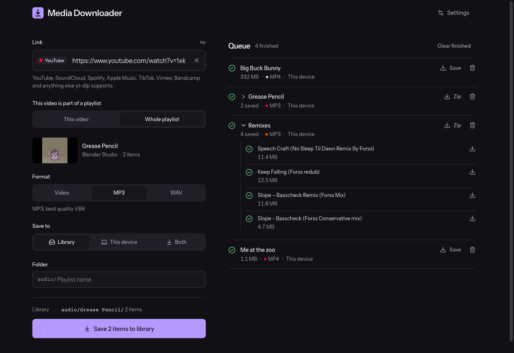
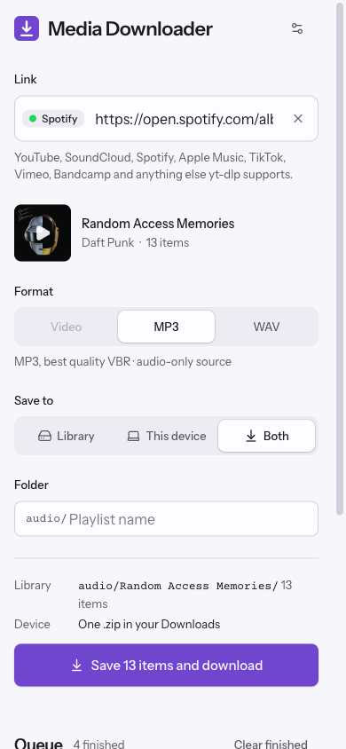
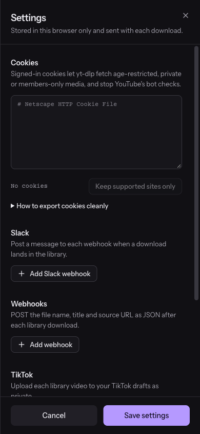

# Media Downloader

A self-hosted web app that wraps [yt-dlp](https://github.com/yt-dlp/yt-dlp). Paste a link and the file goes into your media library (Jellyfin, Plex, anything that watches a folder), to the device you're browsing from, or both. Built with Bun, Fastify, React and Docker.



<p>
  
  &nbsp;
  
</p>

## What it does

- **Sources.** Built-in previews and defaults for YouTube, YouTube Music, TikTok, SoundCloud, Vimeo, Reddit, X, Twitch, Bandcamp, Mixcloud, Internet Archive, Dailymotion and Bilibili. Any other site yt-dlp supports works as a generic link.
- **Spotify and Apple Music.** Playlists, albums and single tracks. These services serve no downloadable audio, so each track is looked up on SoundCloud by artist and title. The search tries up to 5 results and skips DRM-locked (Go+) tracks, but a match can still be a different version or a 30-second preview. Spotify playlists are read from Spotify's public embed page, which lists at most 100 tracks.
- **Playlists.** YouTube playlists and channels, SoundCloud sets and artist pages, Bandcamp albums and similar links are expanded on the server, up to 1,000 items. Each item downloads into a folder named after the playlist unless you type a folder name. Pasting a YouTube video opened from inside a playlist (`watch?v=…&list=…`) offers a choice between that video and the whole playlist.
- **Formats.** MP4 (up to 1080p, H.264 preferred), MP3 (best VBR, with cover art) or lossless WAV. The default depends on the source and is remembered per source.
- **Destinations.**
  - **Library** saves under `downloads/videos` or `downloads/audio`, optionally in a subfolder.
  - **This device** sends the file to your browser. Playlists arrive as one zip.
  - **Both** does both.
- **Queue.** Downloads run on the server, two at a time by default, with live progress over Server-Sent Events. You can close the tab, lock your phone, or check progress from another device. Each job can be cancelled, retried or removed from the list.
- **Trim and rename.** Download only part of a video or track, and set the file name.
- **Hooks.** After each library download the app can post to Slack, POST JSON to webhooks, and upload to TikTok as private. Configure them in Settings.

## Deploy

```yaml
services:
  media-downloader:
    image: ghcr.io/joelwilsonmt/media-downloader-with-hooks:latest
    ports:
      - "9000:3000"
    volumes:
      - "${RIPPER}/Videos/Youtube downloads:/app/downloads"
    env_file:
      - .env
    restart: unless-stopped
```

Every push to `main` builds and pushes the image to GHCR (`.github/workflows/deploy.yml`). Each build installs the latest yt-dlp from PyPI, including the YouTube challenge solver and `curl_cffi` for sites that need browser impersonation. The image also rebuilds weekly, and a running container updates yt-dlp on start and once a day, so extractor fixes arrive without a redeploy.

### Environment

| Variable | Default | |
|---|---|---|
| `PORT` | `3000` | |
| `DOWNLOAD_DIR` | `/app/downloads` in Docker | Library root. Holds `videos/` and `audio/`. |
| `MAX_CONCURRENT_JOBS` | `2` | Parallel yt-dlp processes. Other jobs wait in the queue. |
| `DEVICE_FILE_TTL_MINUTES` | `60` | How long a "This device" file waits on the server before it's deleted. |
| `SLACK_WEBHOOK_URL`, `ENABLE_SLACK` | | Server-side fallback when the browser sends no Slack URLs. |
| `GENERIC_WEBHOOK_URL` | | Server-side fallback webhook. |
| `TIKTOK_*`, `ENABLE_TIKTOK` | | Server-side TikTok credentials. |

The job queue lives in memory. Restarting the container clears its history; files already in the library stay.

## Cookies

Age-restricted, private and members-only media need a signed-in session. YouTube also sometimes asks for one to prove you aren't a bot.

1. Open a private window and sign in to the site only.
2. Export cookies with the **Get cookies.txt LOCALLY** extension (Netscape format).
3. Close the private window right away so the cookies don't rotate.
4. Paste them into Settings, then tap **Keep supported sites only**.

Cookies and hook credentials are stored in your browser's `localStorage` and sent with each request. The server writes cookies to a private temp file for the length of one yt-dlp run, then deletes it.

## Development

Requires [Bun](https://bun.sh).

```bash
bun install
bun run dev        # API on $PORT (default 3000) + Vite on :5173, proxying /api
bun run test       # Vitest
bun run typecheck
bun run lint
bun run build      # UI to dist/web, served by Fastify in production
```

`bun run dev` downloads or updates yt-dlp into `bin/` first. Locally, sites that need browser impersonation also need `curl_cffi` installed for the Python that runs yt-dlp.

### Layout

```
shared/        Service registry and request/response schemas, used by both sides
src/           Fastify server: routes (app.ts), job queue (jobs.ts), yt-dlp wrapper,
               Spotify / Apple Music lookup (catalog.ts), hooks
web/src/       React UI
```

To add a source, add an entry to `SERVICES` in `shared/services.ts` with its hosts, default format, and optionally a playlist rule and an embed builder.

### API

| Method | Path | |
|---|---|---|
| `POST` | `/api/info` | `{ url, cookies? }`: title, length, thumbnail, playlist count |
| `POST` | `/api/jobs` | `{ url, format, destination, folder?, rename?, trim?, cookies?, hooks? }`: queues a job |
| `GET` | `/api/jobs` | All jobs |
| `GET` | `/api/events` | Server-Sent Events: a snapshot, then each job change |
| `POST` | `/api/jobs/:id/cancel`, `/api/jobs/:id/retry` | |
| `DELETE` | `/api/jobs/:id` | Remove from the list (deletes device-only files) |
| `GET` | `/api/jobs/:id/file` | The file, or a zip for a playlist |
| `GET` | `/api/folders?media=audio\|video` | Existing subfolders |

## License

[MIT](LICENSE)
